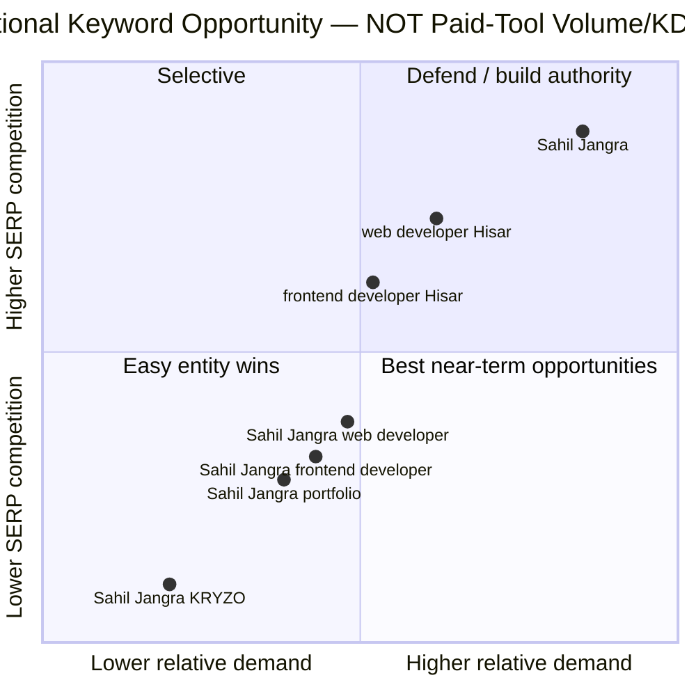
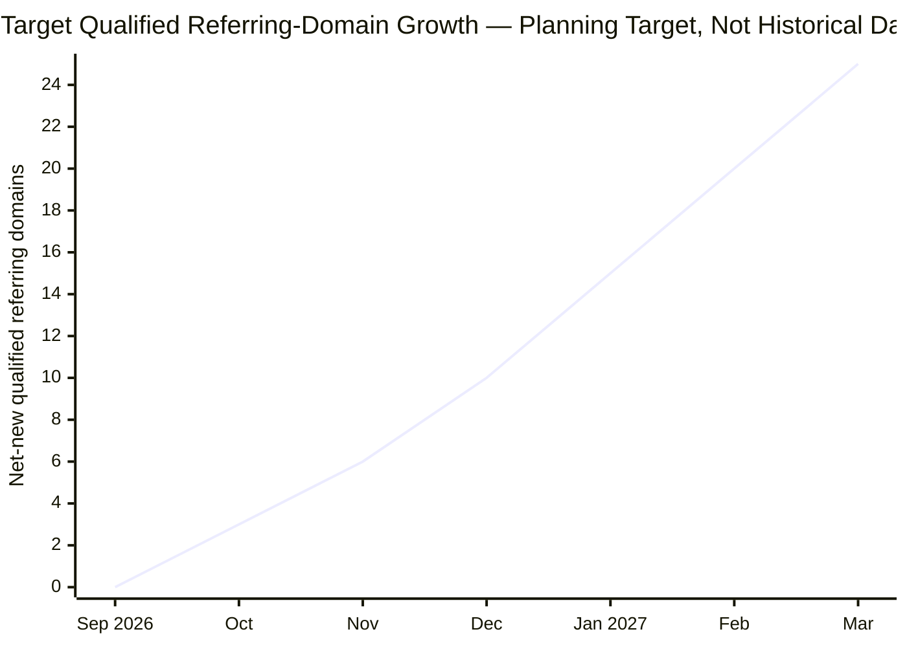
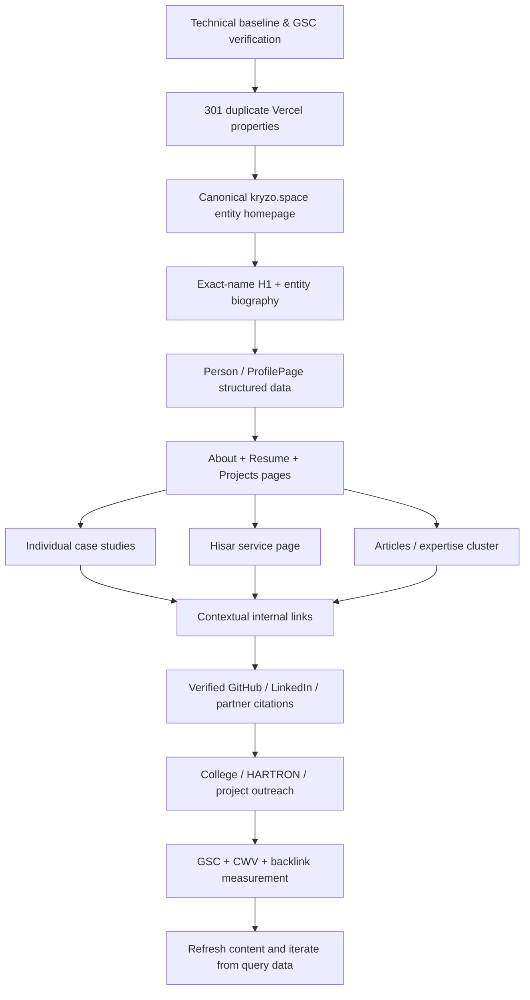

# SEO Research Report: Ranking kryzo.space for “Sahil Jangra”

## Executive summary

**Audit date:** September 28, 2026  
**Primary target:** `Sahil Jangra`  
**Primary domain:** `https://www.kryzo.space/`  
**Data boundary:** Public web, current site/source, public SERP snapshots, Google Search documentation, and public Ahrefs/Semrush documentation. No private Google Search Console, Google Analytics, Ahrefs, Semrush, or Moz account data was available; therefore any metric requiring those accounts is marked **Unspecified** rather than estimated or fabricated.

The core SEO problem is **not basic keyword placement**. kryzo.space already uses “Sahil Jangra” in its title, meta description, image alt text and page copy. The bigger problem is **entity and domain fragmentation**. An essentially identical portfolio at `kryzome.vercel.app` currently surfaces for the exact-name query, while another Sahil Jangra portfolio/resume ecosystem exists at `technologia-ashen.vercel.app`. Meanwhile, the query is highly ambiguous: LinkedIn alone reports more than 400 profiles named Sahil Jangra, and current SERPs also contain a programmer, researcher and numerous unrelated professionals. citeturn26search5turn26search6turn26search7

The highest-impact strategy is therefore:

1. **Make kryzo.space the unequivocal canonical home of this Sahil Jangra.** Permanently redirect the old Vercel portfolio(s) to matching kryzo.space URLs wherever the same owner controls them. Google considers redirects and `rel="canonical"` strong canonicalization signals. citeturn25search2turn25search4
2. **Turn the homepage into a stronger person/entity page.** Change the H1 from “Hi, I’m Sahil. Frontend Dev.” to an unambiguous formulation such as **“Sahil Jangra — Frontend Web Developer in Hisar, India”**, then identify the person consistently with KRYZO, location, profession and verified profiles. The current title is already good, but the H1 omits the surname. citeturn5view1turn5view5
3. **Add structured entity data.** No JSON-LD was found in the inspected source. Add `ProfilePage`/`Person` with verified `sameAs` properties; Google specifically supports `ProfilePage` for pages focused on a single person and documents `sameAs` for external identity references. citeturn5view3turn25search1
4. **Move beyond the current one-page architecture.** Create useful crawlable pages for biography, projects/case studies, resume, services and articles. The present repository is fundamentally a single-page site with anchor navigation, limiting distinct landing pages and internal-link context. citeturn3view0turn25search5turn25search17
5. **Fix production and UX hygiene immediately.** The site loads Tailwind through the Play CDN; Tailwind itself states that this CDN is intended for development rather than production. There is also a broken `#writing` navigation target, placeholder LinkedIn links, stale footer details and an English-site WhatsApp CTA prefilled in Japanese. citeturn25search0turn14view0turn19view0turn9view4
6. **Build corroborating entity links rather than generic volume backlinks.** GitHub, a verified LinkedIn account, Dayanand College, HARTRON, GG Mouse Pro, relevant technical-author profiles and project partners are more strategically useful than indiscriminate directory links because they reinforce *which* Sahil Jangra this site represents. citeturn3view0turn20search0turn20search2turn20search10

### Priority scorecard

| Area | Current assessment | Risk/opportunity | Priority |
|---|---|---|---|
| Canonical/domain consolidation | Homepage has a self-canonical, but duplicate Vercel properties exist in search | Signals may be split between multiple copies | **Critical** |
| Exact-name on-page relevance | Strong title/meta; weaker H1/entity intro | Easy improvement | **Critical** |
| Entity disambiguation | Weak relative to 400+ people with same name | Central challenge for exact-name SERP | **Critical** |
| Structured data | No JSON-LD detected | Missed machine-readable entity context | **High** |
| Architecture | Primarily one HTML page/anchors | Limited topical depth and internal-link graph | **High** |
| Backlinks/entity citations | Private backlink count unavailable; owned profiles are not fully consolidated | Major growth lever | **High** |
| Technical performance | No valid PSI baseline retrieved; production Tailwind CDN is a known implementation issue | Measure and improve | **High** |
| Mobile fundamentals | Responsive viewport/classes and mobile menu present | Good foundation; field UX unverified | **Medium** |
| hreflang | None found | Fine while only one English version exists | **Low** |

**Realistic ranking thesis:** because the current exact-name results are fragmented among unrelated people rather than dominated by one universally recognized Sahil Jangra, there is a credible opportunity to make kryzo.space the primary result for searches that include **Sahil Jangra + web developer / frontend developer / KRYZO / Hisar** first, then strengthen the pure-name query through consistent entity signals. The search snapshot already ranks the duplicate `kryzome.vercel.app`, demonstrating that content associated with this portfolio can surface for the name; the task is to transfer and concentrate those signals on the preferred domain. citeturn26search5turn26search6

## Current site audit

The homepage is publicly fetchable over HTTPS and contains substantial portfolio content: hero, technologies, strengths, experience, projects, education, testimonials and contact information. Its source is also publicly represented in the KRYZO GitHub repository as a largely static, single-page HTML/CSS/JavaScript portfolio. citeturn1view0turn3view0

### Technical SEO findings

| Element | Finding | Assessment | Recommended action |
|---|---|---|---|
| Crawlability | Homepage is accessible. `robots.txt` and `sitemap.xml` could not be reliably verified through the auditing client. | **Needs verification** | Confirm both return HTTP 200. Use a simple permissive `robots.txt` and list canonical URLs in XML sitemap. Submit sitemap in GSC. Google uses sitemaps to discover important URLs. citeturn25search8turn25search21 |
| Index directives | Source contains `robots=index,follow` / Googlebot equivalent. citeturn5view1 | **Good** | Keep. Then validate actual indexing through GSC URL Inspection; an HTML index directive does not prove Google has indexed the page. |
| Canonical | Homepage specifies `https://www.kryzo.space/`; non-www resolves toward the preferred host. citeturn5view1turn13view0 | **Good locally; major cross-domain issue** | Keep self-canonical, but 301 controlled Vercel duplicates into kryzo.space. Redirects are among Google's strongest canonical signals. citeturn25search2 |
| Duplicate content | `kryzome.vercel.app` displays essentially the same Sahil Jangra portfolio and currently surfaces for the name. Another Sahil Jangra portfolio/resume exists at `technologia-ashen.vercel.app`. citeturn26search5turn23search7 | **Critical** | Choose one permanent canonical ecosystem—kryzo.space—and migrate/redirect duplicates. |
| Sitemap | Not confirmed | **Unspecified** | Create/update `sitemap.xml`; include only 200-status canonical indexable pages. Google notes sitemap inclusion is a canonical signal, though weaker than redirects or canonical annotations. citeturn25search2 |
| Structured data | No `application/ld+json` was found in inspected source. citeturn5view3 | **Missing** | Add Person/ProfilePage; Article to articles; BreadcrumbList after moving multi-page. |
| hreflang | No hreflang was found. citeturn5view4 | **Appropriate for now** | Do not add it merely for SEO. Add only if genuine localized/language URL alternatives are launched; Google recommends combining hreflang with canonicalization for regional variants. citeturn25search4 |
| Mobile implementation | Responsive viewport, responsive Tailwind classes and mobile navigation are present. citeturn9view2turn14view3 | **Good foundation** | Test touch targets, menu behavior, CLS and real mobile CWV. |
| Image implementation | Hero has dimensions, descriptive Sahil Jangra alt text and high fetch priority; several below-fold images use lazy loading and dimensions. Some project alt texts are generic (“Project 1”, etc.). citeturn14view4turn5view6 | **Mixed** | Preserve dimensions/lazy loading; replace generic alt with concise project-specific descriptions. |
| CSS/JS delivery | Tailwind Play CDN script, Google Fonts and Font Awesome are loaded externally. citeturn9view1 | **High optimization opportunity** | Compile Tailwind into static production CSS; Tailwind explicitly says Play CDN is development-only. Audit/font-subset or replace icon font with SVGs. citeturn25search0turn25search3 |
| PageSpeed/CWV | A reliable live PSI result was not retrievable in this audit. | **Unspecified** | Establish mobile and desktop PSI baselines after the first fixes. Google's “good” CWV thresholds are LCP ≤2.5 s, INP ≤200 ms and CLS ≤0.1 at the relevant percentile. citeturn10search1 |

**Important performance caveat:** there is not enough evidence to claim that kryzo.space is currently “slow.” The code merely exposes optimization opportunities. Do not report a Lighthouse score until PageSpeed Insights or Lighthouse has actually run successfully. PageSpeed Insights combines lab analysis with real-world data where available. citeturn10search39

### On-page content findings

The current `<title>` is **“Sahil Jangra - Frontend Web Developer | KRYZO”**, which is concise, begins with the exact primary keyword and immediately supplies profession and brand context. The meta description likewise starts with Sahil Jangra and identifies him as a frontend web developer from Hisar, Haryana, India. Those are strong foundations. citeturn5view1

The largest on-page weakness is the H1. The rendered hero says **“Hi, I’m Sahil. Frontend Dev.”**, so the most important visible heading does not state the full entity name. Google recommends putting words users search for in prominent places such as titles and main headings. citeturn5view5turn10search11

**Recommended homepage H1:**

> **Sahil Jangra — Frontend Web Developer in Hisar, India**

Immediately below it, use approximately two concise sentences:

> Sahil Jangra is the frontend web developer behind KRYZO, based in Hisar, Haryana. He builds responsive websites and interactive web experiences using HTML, CSS, JavaScript, React and Tailwind CSS.

This creates natural disambiguation without keyword stuffing. Google explicitly warns against repetitive keyword stuffing and states that it does not use the `meta keywords` tag; the site's large keywords meta tag can therefore be removed without losing a Google ranking signal. citeturn27search0

The page already contains good first-party evidence—projects, technologies, education, experience and contact data—but it lacks a **substantive, uniquely written biography/entity section** that answers “Who is Sahil Jangra?” in a way unrelated Sahil Jangras cannot match. Current search results include a researcher, multiple developers/professionals and more than 400 same-name LinkedIn profiles, making location, brand and project identifiers especially important. citeturn26search2turn26search6turn26search7

Other immediate on-page/UX fixes:

| Issue | Current evidence | Action |
|---|---|---|
| Broken “Writing” navigation | Mobile nav points to `#writing`, but no corresponding section was found. citeturn14view0turn14view3 | Create `/articles/` or remove link until content exists. |
| Placeholder LinkedIn links | Source uses `href="#"` rather than a real LinkedIn profile. citeturn19view0turn19view1 | Identify the correct owner profile; do **not** guess because hundreds of Sahil Jangra profiles exist. citeturn26search6 |
| WhatsApp language mismatch | English site uses Japanese prefilled WhatsApp text. citeturn9view4 | Replace with concise English project-enquiry text. |
| Generic project alt text | “Project 1”, etc. found. citeturn5view6 | Use “GG Mouse Pro website by Sahil Jangra”, etc., where accurately descriptive. |
| Testimonials lack corroborating case-study context | Existing page presents named client stories but little verifiable project detail. citeturn9view3 | Turn genuine engagements into case studies with client/project links, concrete scope and outcomes that can be substantiated. |
| Footer freshness | Rendered site still shows a 2024 copyright year. citeturn1view0 | Make year dynamic/current; minor SEO impact, useful trust hygiene. |

### URL architecture and internal linking

The existing site is effectively a one-page portfolio organized around fragment anchors rather than distinct indexable content URLs. citeturn3view0 That is sufficient for a brochure page, but weak for building a search entity plus topic cluster.

Recommended architecture:

```text
/
├── about/sahil-jangra/
├── projects/
│   ├── gg-mouse-pro/
│   ├── yt-thumbnail-grabber/
│   └── ...
├── resume/
├── services/
│   └── web-development-hisar/
├── articles/
│   ├── frontend-performance-checklist/
│   ├── responsive-web-design-checklist/
│   └── tailwind-portfolio-case-study/
└── contact/
```

Every new page should be linked from at least one crawlable page using descriptive anchors. Google specifically states that internal anchor text helps users and Google understand pages, and its sitelink systems analyze site link structure. citeturn25search5turn25search17

Do **not** create thin pages solely to repeat “Sahil Jangra.” Each URL needs a genuinely different purpose: identity, resume, project evidence, service intent or technical expertise.

### Recommended schema

The strongest entity implementation is a dedicated `/about/sahil-jangra/` page using `ProfilePage` with `Person` as `mainEntity`. Google explicitly describes ProfilePage markup as appropriate where the primary focus is a single person and supports `sameAs` URLs to external profiles. citeturn25search1

A compact implementation model is:

```json
{
  "@context": "https://schema.org",
  "@type": "ProfilePage",
  "@id": "https://www.kryzo.space/about/sahil-jangra/#profile",
  "url": "https://www.kryzo.space/about/sahil-jangra/",
  "mainEntity": {
    "@type": "Person",
    "@id": "https://www.kryzo.space/#sahil-jangra",
    "name": "Sahil Jangra",
    "url": "https://www.kryzo.space/",
    "jobTitle": "Frontend Web Developer",
    "description": "Frontend web developer based in Hisar, Haryana, India.",
    "image": "https://www.kryzo.space/[verified-image-path]",
    "sameAs": [
      "https://github.com/KRYZO-MINE",
      "[VERIFIED-LINKEDIN-URL]",
      "[VERIFIED-OTHER-PROFILES]"
    ]
  }
}
```

Only use verified profiles in `sameAs`. Add `Article`/`BlogPosting` to real articles and connect their `author` back to the person entity; Google recommends using an author URL or `sameAs` to clarify author identity. citeturn25search16

## Keyword strategy

The exact keyword is fundamentally **navigational/entity intent**: a searcher wants information about a person named Sahil Jangra. Because the name maps to many different individuals, modifiers such as *web developer*, *frontend developer*, *Hisar* and *KRYZO* are crucial entity-disambiguation terms rather than mere keyword variants. citeturn26search6turn26search7

### Keyword research and data limitations

Neither Google Keyword Planner/GSC nor an authenticated Ahrefs/Semrush dataset was supplied. Therefore exact monthly volumes and numeric KDs below are **Unspecified**. This is preferable to fabricating numbers: Semrush defines volume as estimated average monthly searches and KD as a proprietary competitive metric, while Ahrefs calculates KD from referring-domain characteristics of top-ranking results; these are third-party estimates, not values directly published by Google. citeturn28search0turn28search2turn28search9

| Keyword | Intent | Monthly volume | Tool KD | Observed/strategic difficulty | Priority |
|---|---|---:|---:|---|---|
| **Sahil Jangra** | Navigational/entity | **Unspecified** | **Unspecified** | High entity ambiguity, but weakly consolidated result set | **P0** |
| Sahil Jangra web developer | Entity + professional | Unspecified | Unspecified | Lower ambiguity; highly aligned | **P0** |
| Sahil Jangra frontend developer | Entity + professional | Unspecified | Unspecified | Strongest profession match | **P0** |
| Sahil Jangra KRYZO | Navigational | Unspecified | Unspecified | Likely very low competition; strong ownership signal | **P0** |
| Sahil Jangra Hisar | Entity/local | Unspecified | Unspecified | Useful disambiguator | **P0** |
| Sahil Jangra portfolio | Navigational | Unspecified | Unspecified | Current Vercel copy already relevant | **P1** |
| Sahil Jangra projects | Navigational/informational | Unspecified | Unspecified | Best served by dedicated projects hub | **P1** |
| Sahil Jangra resume | Navigational | Unspecified | Unspecified | Existing Vercel PDF appears in search | **P1** |
| Sahil Jangra contact | Navigational | Unspecified | Unspecified | Conversion-oriented | **P1** |
| frontend developer Hisar | Commercial/local | Unspecified | Unspecified | Broader competition | **P1** |
| web developer Hisar | Commercial/local | Unspecified | Unspecified | Broader local service competition | **P1** |
| freelance web developer Hisar | Commercial | Unspecified | Unspecified | High business relevance | **P2** |
| JavaScript developer Hisar | Commercial/professional | Unspecified | Unspecified | Narrower secondary term | **P2** |
| Tailwind CSS developer India | Commercial/professional | Unspecified | Unspecified | Broader geography/competition | **P3** |

**Long-tail cluster:** “Sahil Jangra frontend web developer Hisar,” “Sahil Jangra KRYZO portfolio,” “Sahil Jangra frontend projects,” “Sahil Jangra web development projects,” “Sahil Jangra resume frontend developer,” “Sahil Jangra contact Hisar,” and “Sahil Jangra JavaScript developer.” These should be incorporated only where contextually useful, not repeated mechanically; Google says it does not use an “optimal keyword density” and discourages repetitive keyword stuffing. citeturn27search0turn27search2

### Prioritized keyword map

| URL | Primary target | Supporting terms | Suggested title | Suggested H1 | Suggested meta description |
|---|---|---|---|---|---|
| `/` | **Sahil Jangra** | frontend developer, web developer, Hisar, KRYZO | **Sahil Jangra \| Frontend Web Developer in Hisar, India** | **Sahil Jangra — Frontend Web Developer in Hisar, India** | Meet Sahil Jangra, the frontend web developer behind KRYZO in Hisar, India. Explore web projects, skills, experience and ways to get in touch. |
| `/about/sahil-jangra/` | Sahil Jangra web developer | biography, KRYZO, Hisar | **About Sahil Jangra \| Frontend Developer & KRYZO** | **About Sahil Jangra** | Learn about Sahil Jangra’s frontend development background, skills, education, experience and work behind KRYZO. |
| `/projects/` | Sahil Jangra projects | portfolio, web development projects | **Sahil Jangra Projects \| Web Development Portfolio** | **Web Development Projects by Sahil Jangra** | Explore frontend and web development projects created or contributed to by Sahil Jangra. |
| `/resume/` | Sahil Jangra resume | frontend developer CV | **Sahil Jangra Resume \| Frontend Web Developer** | **Sahil Jangra Resume** | View Sahil Jangra’s frontend development experience, education, technical skills and selected projects. |
| `/services/web-development-hisar/` | web developer Hisar | frontend developer Hisar, freelance developer | **Web Developer in Hisar \| Sahil Jangra – KRYZO** | **Freelance Web Developer in Hisar** | Frontend and website development services in Hisar by Sahil Jangra, focused on responsive, usable and modern web experiences. |
| `/articles/` | Sahil Jangra web development articles | frontend articles, JavaScript, Tailwind | **Web Development Articles by Sahil Jangra** | **Frontend & Web Development Articles** | Practical frontend development articles and project lessons from Sahil Jangra. |
| `/projects/gg-mouse-pro/` | GG Mouse Pro Sahil Jangra | technical associate, case study | **GG Mouse Pro Case Study \| Sahil Jangra** | **Sahil Jangra’s Work with GG Mouse Pro** | A transparent case study describing Sahil Jangra’s verified role, work, technologies and outcomes with GG Mouse Pro. |

The current homepage title is already close to the recommended version, so the more important changes are **H1/entity clarity, unique supporting copy, consolidation of duplicates and external corroboration**, not endless title rewriting. citeturn5view1turn26search5

### Keyword difficulty vs. volume visualization

A numerical volume-vs-KD scatter plot would be misleading without authenticated Keyword Planner/Semrush/Ahrefs values. Semrush and Ahrefs both characterize their difficulty figures as estimates, and Ahrefs explicitly recommends manual SERP analysis in addition to KD. citeturn28search2turn28search4

The following is therefore a **directional planning proxy only**. Coordinates express relative expected demand and current SERP competition on a 0–1 planning scale; **they are not search-volume or KD measurements**.



The strategic implication remains valid regardless of paid-tool numbers: **win the strongly identifying branded long tails first, then use those entity signals to improve the unmodified “Sahil Jangra” query.**

## SERP competitors and backlink analysis

### Current exact-name SERP landscape

The following is a point-in-time, unauthenticated search-engine snapshot for `"Sahil Jangra"`. It should be treated as a competitive sample, not a universal Google rank report. Search Console should become the source of truth for kryzo.space's own impressions, query positions and clicks once access is available.

| Snapshot position | Result | Content / intent | Competitive advantage | Numeric backlink/domain metrics |
|---:|---|---|---|---|
| 1 | LinkedIn — Haryana profile | Personal profile | Exact-name entity page on major platform | **Unspecified** citeturn26search0 |
| 2 | LinkedIn — Gurgaon profile | Personal/education profile | Exact-name profile | **Unspecified** citeturn26search1 |
| 3 | LeetCode — `Sahil_Jangra` | Developer/coding profile; extensive problem-solving activity | Strong developer relevance + exact identity | **Unspecified** citeturn26search2 |
| 4 | LinkedIn — Work From Home profile | Professional profile | Exact-name entity page | **Unspecified** citeturn26search3 |
| 5 | LinkedIn — Reliance profile | Frontend-developer profile | **Direct profession overlap** with target Sahil | **Unspecified** citeturn26search4 |
| 6 | `kryzome.vercel.app` | **Same portfolio/persona as kryzo.space** | Exact portfolio content already recognized in search | **Unspecified** citeturn26search5 |
| 7 | LinkedIn directory | 400+ people named Sahil Jangra | Massive entity aggregation | **Unspecified** citeturn26search6 |
| 8 | ResearchGate — IIT Delhi PostDoc | Researcher identity/publications | Verified academic affiliation + publications | **Unspecified** citeturn26search7 |
| 9 | LinkedIn — Delhi profile | Education/profile | Exact name | **Unspecified** citeturn26search8 |
| 10 | LinkedIn — Bengaluru profile | Technical/student profile | Exact name + technical activity | **Unspecified** citeturn26search9 |

The important competitive insight is that **kryzo.space is not principally competing against ten other frontend portfolio sites**. It is competing against Google's need to resolve an ambiguous human name. Current results include unrelated people from different professions and geographies, and LinkedIn explicitly lists hundreds of matches. citeturn26search6

That changes the SEO playbook. A conventional “publish 50 generic web-development articles” strategy is less important initially than creating a coherent entity graph:

```text
Sahil Jangra
   │
   ├── kryzo.space  ← canonical entity home
   ├── KRYZO
   ├── Hisar, Haryana
   ├── Frontend Web Developer
   ├── verified GitHub
   ├── verified LinkedIn
   ├── verified DEV/author profile
   ├── GG Mouse Pro project evidence
   ├── HARTRON education/training
   └── Dayanand College education
```

### Backlink profile

**Current number of backlinks:** Unspecified.  
**Current number of referring domains:** Unspecified.  
**Ahrefs DR / Moz DA / Semrush Authority Score:** Unspecified.  
**Anchor-text distribution:** Unspecified.  
**Historical backlink growth:** Unspecified.  
**Confirmed toxic links:** None can responsibly be identified from the available public dataset.

A proper toxic-link or anchor-text analysis requires an export from **GSC → Links**, Ahrefs Site Explorer, Semrush Backlink Analytics/Audit or an equivalent crawler. It would be irresponsible to label a domain “toxic” solely because it looks unfamiliar.

Do not overreact to low-quality links once data is obtained. First classify links by source relevance, indexing, spam patterns, anchor manipulation and whether they appear intentionally acquired. The main near-term weakness visible publicly is not a confirmed toxic profile but **missing consolidation of highly relevant owned and relationship-based links**.

The GitHub footprint associated with KRYZO already identifies Sahil Jangra and the portfolio project, but references around the ecosystem have pointed to older Vercel properties rather than consistently reinforcing kryzo.space. citeturn2view0turn3view0

### Highest-value link and entity opportunities

| Opportunity | Why it matters | Contact / URL | Recommended ask |
|---|---|---|---|
| **KRYZO GitHub profile + repositories** | Fully controlled and technically relevant; fastest entity citation | [github.com/KRYZO-MINE](https://github.com/KRYZO-MINE); existing profile identifies Sahil Jangra. citeturn2view0 | Change website/profile/README links from any old Vercel URL to `https://www.kryzo.space/`; link project case studies. |
| **Verified personal LinkedIn** | High-value person/entity corroboration, but correct account must be verified because 400+ same-name profiles exist. citeturn26search6 | Owner must identify the correct profile | Add kryzo.space to Contact Info and Featured; align name, headline, Hisar/KRYZO and profession. |
| **GG Mouse Pro** | Portfolio already claims a project/technical relationship; a genuine partner attribution is far stronger than a generic directory backlink. citeturn24search12 | `support@ggmousepro.com`; [ggmousepro.com](https://ggmousepro.com/) contact is published in its policy. citeturn20search0 | Request a factual “website/technical contribution by Sahil Jangra” credit or case-study reference only if the relationship can be verified. |
| **Dayanand College, Hisar Alumni Association** | Highly relevant education + local entity corroboration; college maintains an alumni section. citeturn20search2 | `principal@dnc.ac.in`, `principal.dnchsr@gmail.com`; [dnc.ac.in/alumni-association.html](https://www.dnc.ac.in/alumni-association.html). citeturn20search2turn20search8 | Ask whether student/alumni achievements or portfolios can be included in an official alumni/profile page. |
| **HARTRON** | Portfolio/resume identifies HARTRON training; official skills portal exists. citeturn23search7turn20search10 | `mdhartron@gmail.com`, `hartron.awarding@gmail.com`; [skill.hartronservices.com](https://skill.hartronservices.com/). citeturn20search10 | Pitch a concise learner/success story only with truthful credential evidence; request a profile link if their policy permits it. |
| **DEV Community** | Search already finds a profile named Sahil Jangra; verify ownership before connecting it to the entity. citeturn20search15 | [dev.to/sahiljangradev](https://dev.to/sahiljangradev) | If owned: complete bio/site link and publish original technical articles that point to deeper kryzo case studies. If not owned, create a clearly differentiated genuine profile. |
| **Project clients/partners** | First-party project citations can prove real-world work and avoid generic “SEO link” patterns | Existing verified partners only | Ask for factual portfolio attribution, testimonial page, team bio or project-credit link. |

**Avoid:** mass directory submissions, paid exact-match anchor packages, comment spam, sitewide footer-link exchanges and fake guest posts. For a personal-name query, a smaller number of consistent, credible identity citations is strategically preferable to manufacturing hundreds of weak links.

Recommended anchor distribution should emerge naturally. Encourage anchors such as **“Sahil Jangra,” “Sahil Jangra – KRYZO,” “Sahil Jangra’s portfolio,” “KRYZO,” “frontend developer Sahil Jangra,”** and plain URL/brand mentions rather than forcing the exact phrase in every backlink.

### Backlink growth visualization

Because there is no verified historical Ahrefs/GSC export, the requested timeline below is a **forward target for cumulative new qualified referring domains**, not claimed historical backlink growth.



Quality criteria should be stricter than the numeric target: indexed source, real editorial/contextual relevance, unique site/operator, non-spam placement and a credible relationship to Sahil Jangra, KRYZO, Hisar, education or actual development work.

## Actionable roadmap

The fastest ranking improvement is likely to come from **consolidation → entity clarity → indexable supporting pages → corroborating links**, rather than from publishing large amounts of unrelated blog content.

### Immediate technical and entity fixes

**Critical — first deployment**

| Task | Exact implementation | Effort | Expected SEO impact |
|---|---|---:|---|
| Consolidate Vercel duplicates | 301 `kryzome.vercel.app` and any same-owner duplicate portfolio URLs to the closest kryzo.space equivalents. Remove duplicate indexable copies. | 2–5 h | **Very high** |
| Validate canonical/indexing | Self-canonical every page; ensure all navigation, sitemap and OG URLs use `https://www.kryzo.space/`. Inspect homepage in GSC after deployment. Google recommends URL Inspection to see Google-selected canonical. citeturn25search14 | 1–2 h | **Very high** |
| Rewrite H1/hero intro | Exact entity name + profession + Hisar + KRYZO naturally in first screen/intro | <1 h | **High** |
| Add Person/ProfilePage schema | Verified name, URL, photo, profession, sameAs links | 1–2 h | **High** |
| Fix `#writing` and LinkedIn `#` | Remove dead targets or create real destinations | <1 h | Medium |
| Create sitemap/robots if absent | Sitemap canonical URLs; reference sitemap from robots.txt; submit through GSC. citeturn25search8turn25search21 | 1 h | Medium/high |
| Remove meta-keywords clutter | Google does not use it. citeturn27search0 | 5 min | Hygiene |
| Replace Play CDN | Build/minify Tailwind into static CSS; Tailwind says Play CDN is development-only. citeturn25search0turn25search3 | 2–5 h | Medium/high |
| Fix WhatsApp/footer/project alts | English CTA, current footer, meaningful image descriptions | 1 h | UX/trust |

### Content creation plan

**Homepage — “Sahil Jangra” entity hub**

Recommended visible structure:

```text
H1: Sahil Jangra — Frontend Web Developer in Hisar, India

Intro:
Who Sahil is + KRYZO + location + specialty

H2: About Sahil Jangra
80–150 words of unique biography

H2: Selected Web Development Projects
3–4 strongest projects, each linking to a case study

H2: Frontend Development Skills
HTML, CSS, JavaScript, React, Tailwind, responsive design

H2: Experience
Only verifiable roles/contributions

H2: Education & Training

H2: Articles / Development Notes
3 latest useful pieces

H2: Contact Sahil Jangra
Email / verified social profiles
```

**About page — entity disambiguation**

Headline: **“About Sahil Jangra”**

Include unique biography, Hisar/Haryana context, KRYZO relationship, timeline, verified education/training, development focus, professional photo and links to all authoritative profiles. This page should be the canonical destination used as `author.url` from future articles.

**Project case studies**

Do not merely show screenshots. Each case study should include:

> Problem → Sahil's verified role → constraints → approach → technology choices → screenshots/details → outcome → live project/repository where public → lessons learned.

Recommended first headline:

> **How Sahil Jangra Contributed to GG Mouse Pro: Frontend and Technical Case Study**

Only state contributions/outcomes that can be substantiated. The current portfolio and resume already associate Sahil with GG Mouse Pro, making this a logical first case study. citeturn24search12turn23search7

**Initial article set**

1. **How I Build Fast Frontend Websites with HTML, CSS and JavaScript**
2. **A Responsive Web Design Checklist for Small Businesses**
3. **Building a Portfolio UI with Tailwind CSS: Lessons from KRYZO**
4. **How I Approach Mobile-First Frontend Development**
5. **Frontend Performance Checklist: Images, Fonts, CSS and JavaScript**

These should demonstrate genuine expertise rather than exist to repeat the name. Articles can use Google-supported Article markup and reference the author's canonical profile page. citeturn25search16

### Internal-link plan

The homepage should link to every major entity/content hub. Each project should link back to `/projects/`, relevant technologies/articles and the author/about page where useful. Articles should contextually link to related case studies and services. Use anchors that explain the destination: “Sahil Jangra’s frontend projects,” “GG Mouse Pro case study,” “web development services in Hisar,” rather than repeated “click here.” Google's own guidance stresses descriptive internal anchors. citeturn25search5turn25search17

A sensible crawl graph:



### Outreach templates

**Partner/project attribution**

> **Subject:** Sahil Jangra / KRYZO project attribution  
>
> Hi [Name],  
> I’m documenting my verified work on [project] on my portfolio at kryzo.space. I’m creating a detailed case study covering my role in [specific contribution].  
>
> Would your team be comfortable adding a short developer/contributor credit linking to my portfolio, provided the wording accurately reflects the work completed? I’m happy to use whatever wording your team considers factual and appropriate.  
>
> Thanks,  
> Sahil Jangra

**College/alumni profile**

> **Subject:** Dayanand College student/alumni portfolio submission  
>
> Hello,  
> I’m Sahil Jangra, a [student/alumnus — use accurate status] of Dayanand College, Hisar. I maintain a web-development portfolio documenting my projects and technical work.  
>
> Does the college Alumni Association or student-achievement section accept short profiles of students/alumni and their professional portfolios? If eligible, I can provide verified enrollment details, a short biography and my portfolio link.  
>
> Regards,  
> Sahil Jangra

**Technical publication pitch**

> **Subject:** Original frontend development article proposal  
>
> Hi [Editor/Community],  
> I’m Sahil Jangra, a frontend developer based in Hisar. I’d like to contribute an original article on “[specific practical topic].” It would include implementation details, examples and lessons from a real project rather than promotional content.  
>
> Author bio: Sahil Jangra — Frontend Web Developer, KRYZO.  
>
> Portfolio: kryzo.space  
>
> Thanks for considering it.

The objective is **editorial value and identity verification**, not negotiating anchor text.

## Measurement, effort and expected timeline

No ethical SEO report can promise a #1 position or a fixed date. Google controls indexing, canonical selection and ranking; even canonical hints are signals rather than guarantees. citeturn25search2turn25search4 The timeline below is therefore an execution and evaluation framework.

### Implementation schedule

| Phase | Work | Estimated effort | Target completion |
|---|---|---:|---|
| **Critical foundation** | 301 duplicate sites, canonicals, sitemap/robots verification, broken links, H1/hero, schema | 8–14 h | Week 1 |
| **Performance baseline** | Compile Tailwind, optimize fonts/icons/images, PSI mobile/desktop testing | 5–10 h | Weeks 1–2 |
| **Entity architecture** | About, resume, projects hub, contact/service pages, internal linking | 12–22 h | Weeks 2–3 |
| **Case studies** | 2–4 substantial project pages | 12–24 h | Weeks 2–5 |
| **Entity citations** | GitHub and verified social-profile consolidation | 2–5 h | Weeks 1–3 |
| **Relationship links** | GG Mouse Pro, college, HARTRON, genuine project/client outreach | 2–4 h/week | Weeks 3–12 |
| **Expertise content** | 2 high-quality original articles/month initially | 6–12 h/article | Months 2–6 |
| **Measurement/iteration** | GSC queries, index coverage, CWV, backlink and conversion review | 1–2 h/week | Ongoing |

**Likely evaluation windows:** technical and on-page changes can be crawled after Google revisits the URLs, whereas entity consolidation and link authority generally require repeated crawling and signal accumulation. Rather than assuming a specific ranking date, assess performance at approximately 30, 60, 90 and 180 days with GSC data.

### KPI dashboard

| KPI | Source | Baseline now | Goal / interpretation |
|---|---|---:|---|
| Google-selected canonical for homepage | GSC URL Inspection | **Unspecified** | `https://www.kryzo.space/` |
| Indexed duplicate Vercel portfolio pages | GSC / `site:` checks | At least one duplicate currently surfaces publicly. citeturn26search5 | Reduce controlled duplicates toward zero via redirects |
| Average position: `sahil jangra` | GSC Performance | **Unspecified** | Trend toward top 10 → top 5 → top 3 |
| Average position: `sahil jangra web developer` | GSC | **Unspecified** | Top 3 |
| Average position: `sahil jangra frontend developer` | GSC | **Unspecified** | Top 3 |
| Impressions/clicks: branded entity cluster | GSC | **Unspecified** | Month-over-month growth |
| Branded CTR | GSC | **Unspecified** | Improve after title/entity result becomes recognizable |
| Valid canonical indexable pages | GSC | Current site primarily one page citeturn3view0 | All strategic URLs indexed; thin URLs excluded |
| Referring domains | GSC/Ahrefs/Semrush | **Unspecified** | Quality growth, proposed +25 qualified RDs over ~6 months |
| Anchor-text distribution | Ahrefs/Semrush/GSC | **Unspecified** | Primarily natural brand/name/URL mix; no artificial exact-match concentration |
| LCP p75 | PSI/CrUX | **Unspecified** | ≤2.5 s “good” threshold citeturn10search1 |
| INP p75 | PSI/CrUX | **Unspecified** | ≤200 ms “good” threshold citeturn10search1 |
| CLS p75 | PSI/CrUX | **Unspecified** | ≤0.1 “good” threshold citeturn10search1 |
| Broken navigational links | Crawl | `#writing` and LinkedIn placeholders currently observed citeturn14view0turn19view0 | Zero |
| Schema validation | Rich Results Test / validator | JSON-LD not detected citeturn5view3 | Valid Person/ProfilePage and relevant article markup |
| Contact conversions | GA4 or lightweight analytics | **Unspecified** | Track mail, WhatsApp and project-enquiry conversions |

### Final prioritization

The **first five actions** should be executed before any large-scale content or link-building campaign:

**P0:** Redirect/consolidate `kryzome.vercel.app` and any controlled duplicate portfolio domain into `www.kryzo.space`. The fact that the Vercel duplicate already appears in an exact-name search makes this the strongest immediately visible SEO signal leak. citeturn26search5turn25search2

**P0:** Replace the homepage H1 with **“Sahil Jangra — Frontend Web Developer in Hisar, India”** and add a genuinely useful 100–200-word Sahil Jangra/KRYZO biography near the top. The exact name is already present in metadata, but not in the principal H1. citeturn5view1turn5view5

**P0:** Add `ProfilePage` + `Person` JSON-LD using only verified external profiles, and make those same profiles link back to kryzo.space. This addresses the central problem of distinguishing one Sahil Jangra from hundreds of namesakes. citeturn25search1turn26search6

**P1:** Build `/about/sahil-jangra/`, `/projects/`, `/resume/`, `/services/web-development-hisar/` and `/articles/`, then connect them with concise descriptive internal links. Google uses links for discovery and recommends relevant internal anchor text. citeturn25search5turn25search6

**P1:** Secure a small number of **verifiable entity backlinks**—first from controlled GitHub assets, then genuine project/education relationships such as GG Mouse Pro, Dayanand College and HARTRON—before pursuing generic guest-post volume. citeturn2view0turn20search0turn20search2turn20search10

The strategic objective is to make every reliable signal tell the same story: **Sahil Jangra → frontend web developer → KRYZO → Hisar, Haryana → kryzo.space**. Given the current exact-name SERP's heavy identity ambiguity and the fact that an older copy of this portfolio already surfaces for the query, concentrating those signals on one authoritative domain is a materially stronger path to the top than simply increasing keyword repetition on the existing one-page site. citeturn26search5turn26search6